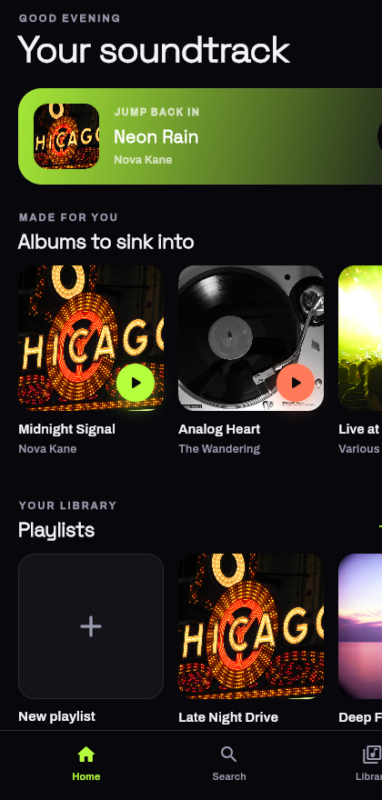

# Tempo — Music Experience

A dark, animated music discovery and playlist app with a fully simulated
player. Built with **Flutter** and **Cubit (`flutter_bloc`)**.

<p align="center">
  
</p>

## Highlights

- **Browse** albums, playlists and tracks using realistic sample data.
- **Create and edit playlists**, pick cover art and add/remove tracks.
- **Simulated player** with play / pause, seek, next / previous, shuffle and
  repeat — no streaming required.
- **Animated mini-player** that expands into a **full-screen player**.
- **Search** across songs, albums and playlists.
- Graceful empty states and validation.

## Motion & interaction

- A persistent **mini-player** that grows into the full player and back.
- **Hero** transition of the album artwork between mini and full player.
- Spinning **vinyl disc** that rotates only while music is playing.
- `AnimatedSwitcher` transitions for artwork, titles and play/pause state.
- Custom **equalizer bars** that dance on the currently playing track.
- Animated progress driven by the player timer, with a draggable scrubber.

## Architecture

```
lib/
├── main.dart                     # entry point + repository wiring
├── app.dart                      # providers + MaterialApp (dark theme)
├── core/                         # theme, typography, sample library, helpers
├── data/
│   ├── models/                   # Track, Album, Playlist
│   └── repositories/             # TempoRepository + LocalTempoRepository
├── features/
│   ├── layout/                   # app shell + bottom navigation
│   ├── home/                     # shelves + "jump back in"
│   ├── search/                   # search results
│   ├── library/                  # playlists + saved albums (its own cubit)
│   ├── album/
│   ├── playlist/                 # detail, reorder, add-tracks, edit sheet
│   └── player/                   # PlayerCubit, mini player, full player
└── widgets/                      # Cover, TrackTile, PlayingBars, cards
```

### State (Cubit)

| Cubit | Responsibility |
| --- | --- |
| `LibraryCubit` | playlists (CRUD, add/remove tracks, reorder) + search query |
| `PlayerCubit` | queue, current track, play state, position (timer), shuffle, repeat, likes |

The **player is simulated** with a periodic timer that advances the position
and auto-advances to the next track, honouring shuffle and repeat.

### Persistence

Playlists and liked tracks are stored locally as JSON in
`shared_preferences` through `TempoRepository`.

## Getting started

```bash
# from the tempo/ directory
flutter pub get

flutter run -d chrome        # quick preview in the browser
flutter run                  # run on a connected phone
```

Release web build:

```bash
flutter build web --release
```

## Notes

- All music content is realistic **sample data** (`core/sample_library.dart`);
  nothing is streamed.
- Artwork and fonts are open-licenced — see
  [`docs/ATTRIBUTIONS.md`](docs/ATTRIBUTIONS.md).

## Tech

Flutter · Dart · `flutter_bloc` (Cubit) · `equatable` · `shared_preferences`.
